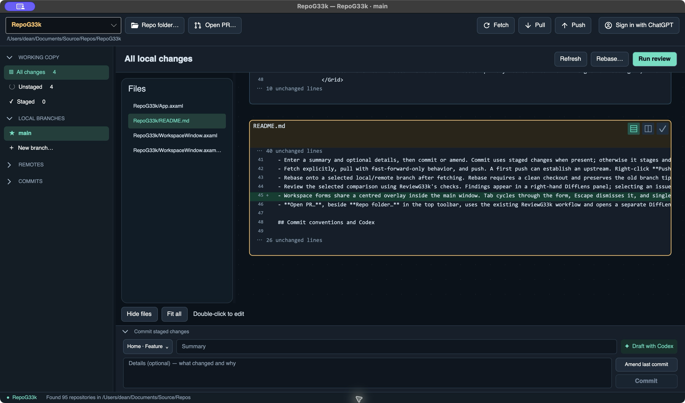

  

# RepoG33k

**See the whole change. Review it. Ship it.**

RepoG33k brings visual code review and everyday Git work into one desktop app. Explore changes across your repository on a zoomable **DiffLens** canvas, then stage, commit, and push from the same workspace.

**[Download the latest release →](https://github.com/deanthecoder/RepoG33k/releases/latest)** · Windows · macOS (Apple Silicon and Intel)

## Why use it?

- **See changes together.** Pan and zoom across files, switch diff modes, and focus on the code that matters.
- **Edit while reviewing.** Jump into a file directly from the canvas, with autosave and undo/redo.
- **Keep Git close.** Stage, commit, amend, fetch, pull, push, and manage or rebase branches.
- **Find issues faster.** Run code review checks, jump to findings, and ignore or restore issues as you work.
- **Review Bitbucket PRs.** Open a pull request URL in an isolated review workspace.
- **Draft commit messages with Codex.** Get an editable summary and details, with per-repository prefixes and Jira IDs detected from branch names.

## Get started

1. Install [RepoG33k](https://github.com/deanthecoder/RepoG33k/releases/latest) and [Git](https://git-scm.com/downloads).
2. Choose your repositories folder and select a repo.
3. Explore your changes in DiffLens, run a review, or make your next commit.

Codex drafting is optional and uses an installed Codex CLI with your ChatGPT sign-in.

## More

- [Releases and installers](https://github.com/deanthecoder/RepoG33k/releases)

Built from the DiffLens experience in [ReviewG33k](https://github.com/deanthecoder/ReviewG33k), with its own codebase and releases.
