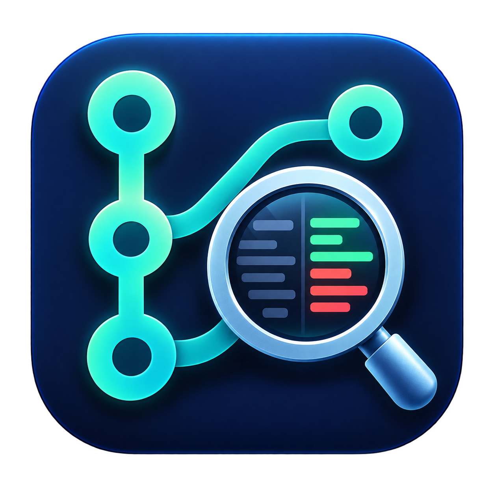
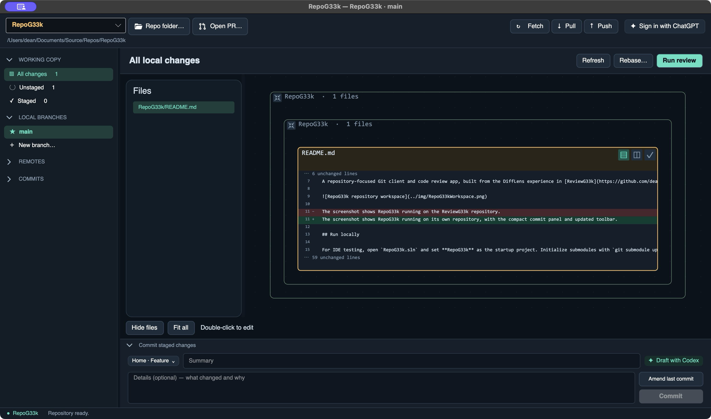

# RepoG33k

[](https://github.com/deanthecoder/RepoG33k/stargazers)

<p align="center"></p>

A repository-focused Git client and code review app, built from the DiffLens experience in [ReviewG33k](https://github.com/deanthecoder/ReviewG33k). It includes a **DiffLens canvas and editor**, including pan/zoom, unified and side-by-side comparisons, autosave, undo/redo, and review finding markers.



The screenshot shows RepoG33k running on its own repository, with the compact commit panel and updated toolbar.

## Run locally

For IDE testing, open `RepoG33k.sln` and set **RepoG33k** as the startup project. Initialize submodules with `git submodule update --init --recursive` after cloning.

Install the .NET SDK 10 (the existing layout tests use its C# compiler), .NET 8 runtime, and Git. From the solution directory:

```sh
dotnet run --project RepoG33k -- --repo /path/to/repository
```

On macOS, double-click **Run RepoG33k.command** in the repository root. It builds a local Release app at `RepoG33k/bin/RepoG33k.app` and opens this repository. Use **Repo folder…** to choose the parent folder containing your repositories, then select one from the repository list. macOS may require choosing a Documents folder repository through its native folder picker on first use.

## Repository workflow

Repository-list badges describe each repo's checked-out branch: **Synced**, **Ahead**, **Behind**, diverged counts, **No upstream**, or **Detached HEAD**. They read local refs in the background (two repositories at a time), reuse results for one minute, and never fetch automatically. Tooltips show the branch, upstream, check time, and last known fetch timestamp. The selected repository shows its status and upstream in the header; Pull and Push include incoming/outgoing counts. **Synced** means matching the locally known upstream, not a fresh server check.

- Right-click a branch to **Delete local branch…** or **Delete remote branch…**. Local deletion uses Git's merged-branch check by default; explicitly allowing unmerged deletion saves a recovery reference, shown in the status bar. Checked-out branches (including linked worktrees) cannot be deleted. Remote deletion checks the inspected remote tip with a lease and keeps local branches. Both actions require confirmation and return to working changes afterward.
- New branches default their starting point to the checked-out branch; creating a tracking branch from a remote keeps that explicit remote starting point.
- Browse local and remote branches without switching the working checkout. Right-click a branch to switch, create a local tracking branch, compare, or review it.
- Select all working changes, staged changes, unstaged changes, or a commit. Branch comparisons show the selected branch's committed snapshot against its merge base with main/master; staged and commit snapshots are read-only.
- The resizable Files panel belongs to the current DiffLens comparison. Select a filename to focus its canvas card, or select a card to highlight and reveal the matching filename. The panel remembers its width and collapsed state; right-click a file to stage, unstage, or reveal it when those actions are available. Double-click an editable line to enter the original DiffLens editor; Escape returns to the canvas. External-change protection refuses to overwrite edits made by another tool.
- Collapse sidebar sections independently; the sidebar scrolls when content is long. The commit composer also collapses, keeping the canvas large. Its convention picker, summary, and Codex draft action share one row.
- Use **Repo folder…** to discover repositories with ReviewG33k's existing discovery service and color-coded repository/ancestor labels. The folder is remembered; right-click the button to refresh its repository list. The active local branch is starred and bold.
- Commits shows up to 100 subjects from the comparison's history, with full text and commit IDs in tooltips. Right-click an entry to copy its full commit ID. Changed paths sort alphabetically without regard to case. Right-click a file to reveal it in Finder/Explorer (available when it exists in the working checkout). The repository path beneath the selector is selectable and can be copied.
- Refreshes and comparison loads expose an enabled **Cancel** action. Cancellation retains the previous canvas. Read-only branch, commit, and staged comparisons reuse up to eight prepared snapshots. Staged views use HEAD plus the staged tree hash: unstaged edits leave the cache valid, while staging, unstaging, committing, or amending selects a new comparison. Branch views invalidate when either branch moves. Working-file views always reload, preserving external-change protection. Cold comparisons batch Git blob reads instead of launching Git for every file; cache hits also reuse prepared diff rows and skip rebuilding history.
- On an unstaged file card, the checkmark offers **Stage file and collapse**, staging all working changes in that file. Staged/commit review cards keep **Mark reviewed and collapse**; expanding a collapsed card never unstages it.
- Right-click **Unstaged** in Working Copy to **Stage all**, or **Staged** to **Unstage all**. These are disabled when there is nothing to move.
- Use `+` to stage a file's working changes and `−` to unstage it. A partially staged file exposes both actions. This first version stages entire files, not individual hunks.
- Enter a summary and optional details, then commit or amend. Commit uses staged changes when present; otherwise it stages and commits all working changes, including untracked files. RepoG33k rejects a commit if its staged tree changed outside the app since refresh. Enabling Amend loads the previous commit's summary and details into empty fields; if a draft exists, choose whether to use the previous message or keep the draft. Amend also asks before rewriting the last commit.
- Fetch explicitly, pull with fast-forward-only behavior, and push. A first push can establish an upstream. Right-click **Push** for a separately confirmed **force-with-lease** push after rewriting published commits; the lease uses the remote commit shown in the workspace and is not silently updated by background fetching.
- Rebase onto a selected local/remote branch after fetching. Rebase requires a clean checkout and preserves the old branch tip under `refs/difflens/recovery/`. Conflicts show continue/abort controls and a **Copy Codex task** handoff. Integrated automatic conflict resolution is not implemented yet.
- Review the selected comparison using ReviewG33k's checks. Findings appear in a right-hand DiffLens panel; selecting an issue focuses it on the canvas. **Hide/Show issues** collapses that panel; review markers remain visible in the canvas. **Results…**, anchored at the bottom-right of the findings panel, opens the shared ReviewG33k results dialog. **Ignore/Restore** controls which findings appear in the panel and canvas; checkbox selections stay separate. Both choices are retained when reopening the dialog during the current review. If all findings are ignored, Results remains available to restore them. Dialog previews use the exact reviewed content. **Open (DiffLens)** focuses the selected finding on the canvas. Moving to a different scope hides those results. Binary/unavailable files are excluded from checks and reported as skipped.
- **Open PR…**, beside **Repo folder…** in the top toolbar, uses the existing ReviewG33k workflow and opens a separate DiffLens window on an isolated Bitbucket PR worktree. Only the PR URL is required. Clones and review worktrees live in a private temporary folder for the app session and are deleted when RepoG33k exits normally. A crash or files locked by another app can leave temporary files behind. Bitbucket authentication continues to use the existing app behavior.

## Commit conventions and Codex

The convention picker saves a format for each repository:

- **Home:** `Fix:`, `Feature:`, or `Other:`.
- **Work:** a Jira story ID detected from the current branch, for example `feature/TS-1234-SpeedUpApp` produces `[TS-1234]`. A missing or ambiguous ID requires an explicit per-commit override. Overrides clear after committing or changing branch.

**Sign in with ChatGPT** connects to an installed Codex CLI through its local app-server. Codex owns the browser sign-in, credential persistence, and token refresh. RepoG33k does not read or store tokens. An existing ChatGPT-backed CLI login can be reused. Available usage is determined by the connected account.

**Draft with Codex** starts a read-only turn in the repository and asks Codex to inspect staged changes, or working changes including untracked files when nothing is staged, and draft a structured summary and details. Codex is encouraged to use credits sensibly, start with an overview, and inspect representative diffs selectively while recognizing meaningful dependency or asset changes. The app applies the prefix itself. The draft dialog has separate editable summary and details fields; accepting it applies those edits to the commit composer. Cancelling leaves the current message unchanged. Previewing or accepting a draft does not commit. Cancellation interrupts the Codex turn.

The CLI is discovered on PATH, common macOS installation paths, or through an explicit `REPOG33K_CODEX_PATH` environment variable (the earlier `DIFFLENS_CODEX_PATH` name remains supported). The integration follows the [Codex app-server protocol](https://learn.chatgpt.com/docs/app-server). Local protocol tests cover sign-in notifications, structured drafting, read-only settings, and cancellation without making model calls. Commit drafting with an existing ChatGPT-backed Codex login has also been exercised manually; protocol tests make no model calls.

## Shared implementation

The native **About RepoG33k** menu uses DTC.Core's standard About dialog, matching ReviewG33k and the other DTC apps. Workspace message boxes size to their content rather than reserving a fixed minimum height.

This repository contains its own copy of the ReviewG33k services and DiffLens components. `Shared/ReviewG33k.Shared.csproj` compiles the copied services and views; Changes here do not modify the ReviewG33k repository.

Workspace preferences and unfinished drafts are stored in the user's local application-data directory under `RepoG33k/workspace.json`, separately from ReviewG33k. Existing settings from the early DiffLens desktop preview are imported automatically when no RepoG33k settings exist. Nothing is added to the repositories being reviewed.

Run validation from the solution root:

```sh
dotnet build RepoG33k.sln
dotnet test ReviewG33k.Tests/ReviewG33k.Tests.csproj
```
